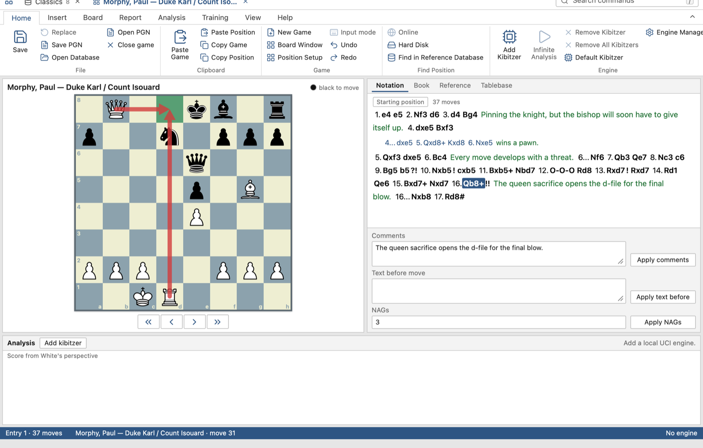
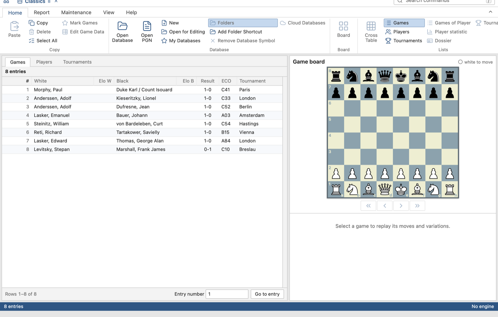
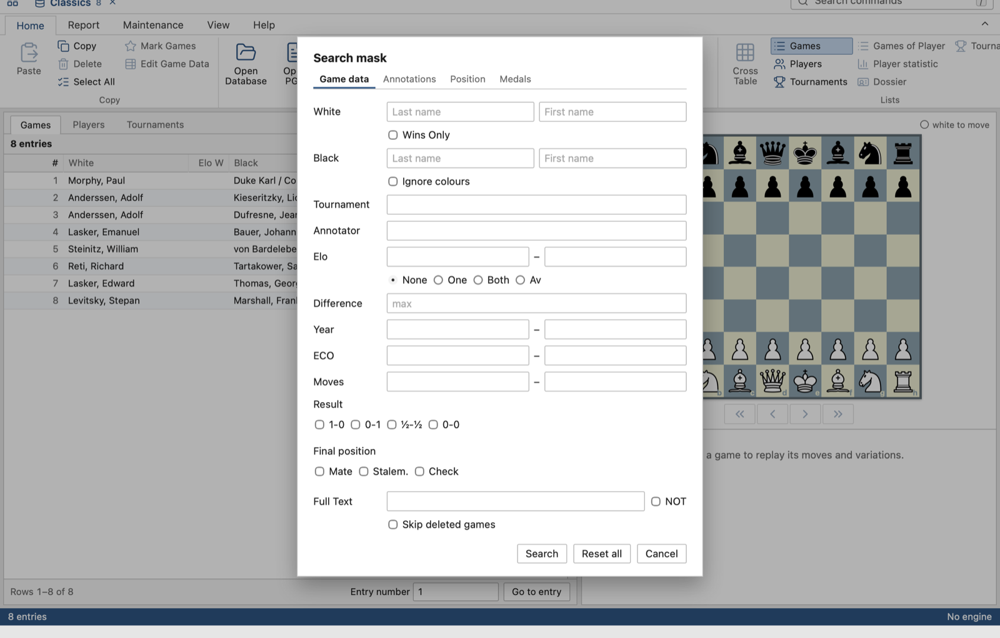
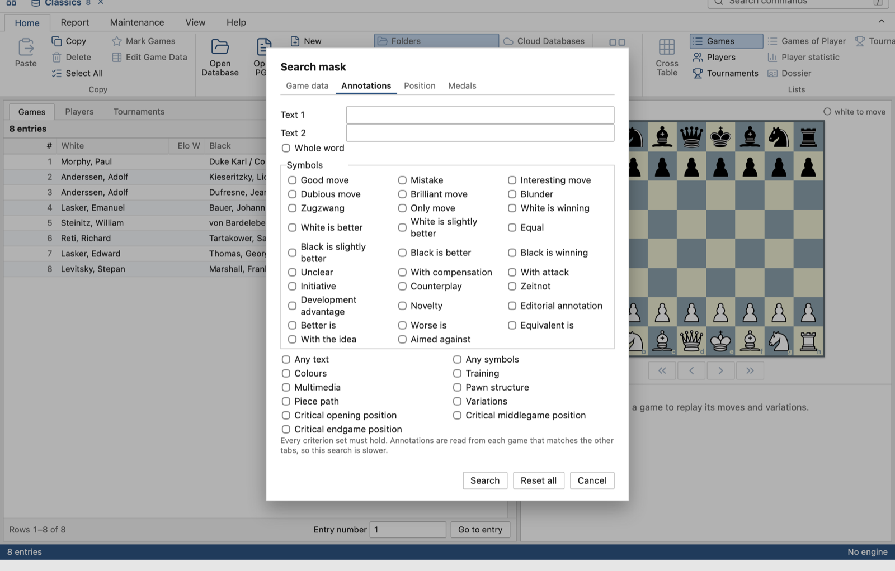
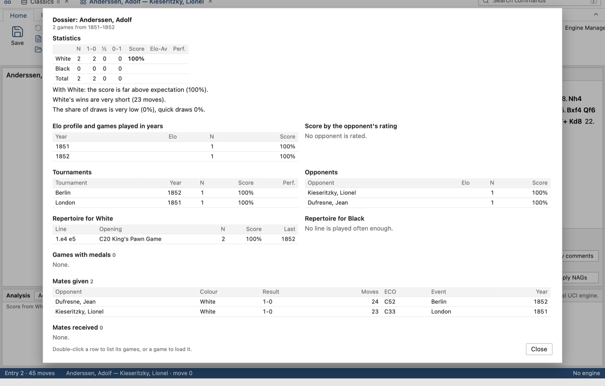
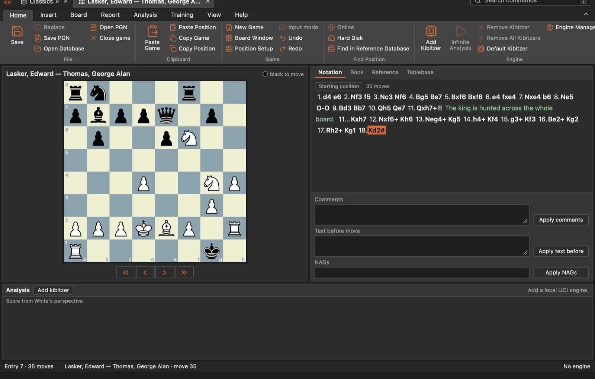

<div align="center">
  
  <h1>OpenFile</h1>
  <p><strong>Your chess databases, on any desktop, free and open source.</strong></p>
  <p>
    <a href="#get-started">Get started</a> ·
    <a href="#what-it-does">Features</a> ·
    <a href="#use">Use</a> ·
    <a href="#documentation">Docs</a> ·
    <a href="feature_checklist.md">Feature checklist</a>
  </p>
  <p>
    <a href="LICENSE"></a>
    
    
    
  </p>
</div>



OpenFile is a desktop chess database app for macOS, Windows and Linux.
It opens the databases you already have, in the classic `.cbh` format and
the newer `.2cbh`. You can browse, search, analyse and edit them in a fast,
familiar window that looks and handles like the desktop database software
you may know.

OpenFile is an independent project, not affiliated with any chess software
vendor. It reads and writes these file formats from your own files,
reimplemented independently. No third-party code,
artwork or games ship with it.

## What it does

| Browse | Analyse | Prepare |
| :--- | :--- | :--- |
| Open `.cbh` and `.2cbh` databases, even 11 million games | Any UCI engine, MultiPV, several kibitzers | Prepare against White or Black |
| Sort, filter and search by game data, position, annotations, medals | Blunder check, deep analysis, analysis jobs | Player statistics, dossier and playing style |
| Opening tree, reference search, crosstables | Syzygy tablebases in analysis and notation | Personal White/Black repertoire workspace, opening, tournament and error reports |
| Edit games and write `.2cbh`; PGN in and out | Comments, symbols, arrows, variation tools | A familiar ribbon, shortcuts and themes |

Everything runs on your computer: no account, no network, nothing uploaded.
See the [feature checklist](feature_checklist.md) for what is done and what
is planned, mapped against the ~180 features of an established desktop
database app.

<details>
<summary><strong>Explore the windows</strong> · Game list, search mask, dossier, dark theme</summary>

<table>
  <tr>
    <td></td>
    <td></td>
  </tr>
  <tr><td align="center">Database window</td><td align="center">Search mask</td></tr>
  <tr>
    <td></td>
    <td></td>
  </tr>
  <tr><td align="center">Annotation search</td><td align="center">Player dossier</td></tr>
</table>



The screenshots show eight classic games from 1851–1912, with comments
written for this README: [docs/media/showcase.pgn](docs/media/showcase.pgn).
`cargo run -p cbh-reader --example pgn_to_2cbh -- docs/media/showcase.pgn Classics.2cbh`
turns them into a database.

</details>

<details>
<summary><strong>Everything in detail</strong></summary>

- **Open your existing databases.** It reads the classic CBH family and
  the newer 2CBH family: games, variations, comments, symbols, arrows,
  coloured squares and Chess960 games. It reads players, tournaments,
  annotators, sources and teams too. It was tested against the 11-million-game
  classic the test database and a 2CBH copy of its first 24,783 games.
- **Fast on huge databases.** The game list scrolls the whole database, every
  row. Sort by any column in under a second on 11 million games, and jump
  straight to any entry.
- **Familiar muscle memory.** The ribbon has the familiar tabs, command names
  and default shortcuts, and its White, Blue, Gray and Black themes. Press `/`
  to search every command. Several games open in tabs, plus board windows and
  layout presets.
- **Search.** The search mask's game data tab covers players, colours, wins
  only, tournament, annotator, Elo, year, ECO, length, result, final position,
  equal final material and full text. Its Material tab finds piece ranges in a move window; its Ending tab finds piece counts in the final position and mates by a chosen combination of pieces; its Annotations and Medals tabs find texts, symbols, colours,
  training, critical positions and medals. **Find Position** and pattern
  searches find every game that reaches a board, faster with a search booster.
- **Opening tree and reference search.** The Book pane shows games, score,
  draw rate, average rating, performance and the year last played for every
  move. The Reference pane follows your board through the database, filters
  moves by both players' Elo, year or an explicit good-game rule, and compares
  a chosen player's White or Black choices with the full position. Games are
  classified by ECO.
- **Players and tournaments.** Every player and tournament is listed with
  game counts and years. Player statistics, dossiers and **Prepare against
  White/Black** show a player's results, opponents and repertoire. Round-robin
  and Swiss crosstables show tiebreaks, performance and FIDE category.
- **Reports.** Opening reports, tournament reports with round-by-round
  standings, an error report that estimates a player's strength from their
  mistakes, and a partial reconstruction of the native playing-style dimensions, with recovered Score/Decided Games calculations and supporting positions.
- **Edit and write.** Enter moves and variations, promote, fold and reorder
  lines, add comments, symbols, arrows and coloured squares, edit game data and
  set up positions, with up to 100 undo steps. Save, replace, delete and mark
  games in `.2cbh` databases, convert `.cbh` to `.2cbh`, copy games between
  databases, check integrity, remove deleted games and find doubles.
- **Engines.** Plug in any UCI engine, such as Stockfish, and manage several.
  MultiPV lines with depth, nodes and scores; paste engine moves into the
  notation. Blunder check and tactical analysis annotate a game; deep
  analysis and analysis jobs run unattended. Guided game review lets you
  retry critical positions and track which ones need practice. Syzygy
  tablebases answer endgames.
- **PGN in and out.** Import PGN collections, and export or copy games as PGN;
  **Export PGN** writes the selected games of a list to a file.
- **Private and safe.** A database is only written when you open it for
  editing. The app keeps its indexes (search booster, opening tree, sort
  orders, name lists) in its own data folder, never beside your files.
- **Repertoire workspace.** From a game board's Repertoire tab, save legal
  opening choices for White and Black, mark a preferred move, add short notes,
  follow saved positions, see unanswered reference replies, and practise your
  own moves. Choices and practice attempts stay in the app's data folder and
  follow the same chess position across move orders and databases.
- **Replay Training Sessions.** Practise saved questions from a game or selected
  game-list rows on a hidden-answer board. Use authored hints and feedback,
  retry questions, and keep progress in the app data folder. **Build Mate
  Training** makes mate-in-1 to mate-in-5 training databases from the games in
  a list (see [mate training](docs/mate-training.md)).

</details>

## Get started

Download the installer for your system from the
[latest release](https://github.com/d4nu-00/openfile/releases/latest):

| System | File |
|---|---|
| macOS, Apple Silicon or Intel | `.dmg` |
| Windows 10 or 11 (x64) | `-setup.exe`, or `.msi` |
| Linux x64 | `.AppImage`, `.deb` or `.rpm` |

macOS on Apple Silicon is used daily. The Windows and Linux builds are made
automatically and have not yet been tried on real machines; please report
anything that goes wrong.

The builds are not signed by Apple or Microsoft yet, so your system warns you
the first time you open the app.

**macOS.** Open the `.dmg` and drag **OpenFile** into
**Applications**. On the first launch, macOS says it cannot verify the app:
1. Click **Done** (not Move to Trash).
2. Open **System Settings › Privacy & Security**, scroll down to
   **Security**, and click **Open Anyway** next to "OpenFile was
   blocked". Confirm with your password.

You only need to do this once. On macOS 14 and earlier, right-clicking the
app and choosing **Open** also works. If macOS instead says the app "is
damaged and can't be opened", that is the download quarantine, not a broken
file. Run this once in Terminal, then open the app normally:

```sh
xattr -dr com.apple.quarantine "/Applications/OpenFile.app"
```

**Windows.** If SmartScreen shows "Windows protected your PC", click **More
info › Run anyway**. The app uses Microsoft Edge WebView2, which Windows 10
and 11 already have.

**Linux.** Make the AppImage executable (`chmod +x`) and run it, or install
the `.deb` or `.rpm` with your package manager. It needs WebKitGTK 4.1
(Ubuntu 22.04, Debian 12, Fedora 36 or later).

Then add an engine: **Add Kibitzer** (Ctrl+K) picks any UCI engine
executable; none is bundled. Homebrew installs Stockfish at
`/opt/homebrew/bin/stockfish` (in the macOS file picker, press ⌘⇧G to type
that path).

### Build from source

You need:
- the [Tauri prerequisites](https://v2.tauri.app/start/prerequisites/) for
  your OS (Xcode command line tools on macOS, WebView2 and the MSVC build
  tools on Windows, WebKitGTK on Linux);
- Rust via rustup (the repository pins 1.99.0);
- Node 24 LTS (`.nvmrc`).

`Cargo.lock` and `package-lock.json` pin every dependency.

```sh
npm ci
npm run tauri -- build
```

That builds the app and every package your platform supports, under
`target/release/bundle/`: `macos/OpenFile.app` and `dmg/…` on macOS,
`nsis/…-setup.exe` and `msi/…` on Windows, `appimage/`, `deb/` and `rpm/` on
Linux. A database named on the command line opens at start, optionally at an
entry:

```sh
openfile "My Games.2cbh" --entry 42
```

<details>
<summary><strong>Development builds, executable only, and making a release</strong></summary>

For just the executable, without installers:

```sh
npm run tauri -- build --no-bundle -- --locked
```

The executable is `target/release/openfile` (`.exe` on Windows).

For development, `npm run tauri -- dev` runs a debug build with hot reload.
`npm run dev` alone serves the interface in a browser with a demo backend
(`/?demo&view=game&entry=11&node=24&theme=black` opens a ready-made game).
Don't use `tauri dev --release`: release builds only load their bundled
pages, so that window stays white.

**Releases.** Pushing a tag such as `v0.1.0` runs
[the release workflow](.github/workflows/release.yml): it builds the
installers on macOS (one universal app), Windows and Ubuntu 22.04, and
attaches them to a draft GitHub Release with the notes in
`docs/releases/<tag>.md`. The draft is published by hand once checked.
macOS builds are ad-hoc signed but not notarised; signing and notarising
needs an Apple Developer ID, and a Windows code-signing certificate removes
the SmartScreen warning.

</details>

## Use

**Opening a database.** Choose **Open Database** (Ctrl+O; Ctrl means ⌘ on
macOS) and pick a `.cbh` or `.2cbh` file. Keep its companion files beside it
with the same name: `.cbg` holds moves, `.cbp`/`.cbt` names, `.cba`
annotations. Anything missing or not understood is reported, never guessed.

**Databases in iCloud Drive.** With "Optimize Mac Storage" on, macOS
removes the contents of files in iCloud Drive (such as `~/Documents`) when
space runs low, and downloads them again when they are read. A large
database can then take minutes, or for ever when iCloud cannot download,
before it opens. OpenFile checks first: it says how much of the database is
only in iCloud and offers **Download and Open**, with progress in the status
bar; **Stop** ends the wait. To keep a database on your Mac for good,
right-click its folder in Finder and choose **Keep Downloaded**, or keep it
outside iCloud Drive.

<details>
<summary><strong>The database window</strong> · Games, Players and Tournaments</summary>

| To | Do |
|---|---|
| Preview a game | Click it |
| Move through the list | Up/Down |
| Open the game in its own tab | Enter or double-click |
| Sort | Click a column header: ascending, then descending, then back to entry order |
| Select games | Ctrl- and Shift-click, or **Select All** (Ctrl+A) |
| Copy and paste games | **Copy** (Ctrl+C), then **Paste** (Ctrl+V) into a database opened for editing |
| Search | **Filter Games** (Ctrl+F) opens the search mask; **Reset Filter** shows everything again |
| Crosstable | **Cross Table** (T) for the chosen or loaded game's tournament |

</details>

<details>
<summary><strong>The game window</strong> · Board, notation and engine</summary>

| To | Do |
|---|---|
| Replay moves | Left/Right, Home and End |
| Jump to a move | Click it in the notation |
| Add a move | Click a piece, then its destination, or drag it there with mouse or touch |
| Draw arrows and squares | Right-click a square or right-drag an arrow (or Alt with the left button); green, Shift for red, Ctrl for yellow |
| Edit game data | F2 |
| Add symbols | Annotation palette, Ctrl+Alt+S |
| Undo | Ctrl+Z |
| Flip the board | Ctrl+F |
| Load the next or previous game of the list | F11 / Ctrl+F11 |
| Opening book | **Book** tab (Ctrl+F12) |
| Your opening choices | **Repertoire** tab; choose White or Black, save moves, or practise on the board |
| Engine analysis | **Infinite Analysis** (Alt+F2) |
| Practise authored questions | **Training › Replay Training**; in the database window choose **Replay Selected Games** for selected rows |
| Find the position in the database | **Find Position › Hard Disk** |

</details>

**Writing.** Databases are written only in the `.2cbh` format, and
only when you ask. **New** (Ctrl+X) creates a database; **Open for Editing**
opens an existing `.2cbh` after a warning. **Save** (Ctrl+S) appends the game,
**Replace** (Ctrl+R) overwrites the game it came from, and **Delete** marks
games deleted. Classic `.cbh` databases always open read-only; without an
editable database, Save writes PGN. A Check Integrity in other database software rebuilds its
own index files after the workbench writes.

**Faster searches and trees** (Maintenance tab). **Create Search Booster**
speeds up position searches. **Create Opening Tree** feeds the Book and
Reference panes; it takes about ten minutes for the 11-million-game test database.

## Not there yet

- Training: calculation training and automatic generation of new questions.
- Printing and importing the local repertoire workspace.
- Text entries, printing, diagram lists and HTML publishing.
- Correspondence chess, and playing against an engine.
- Vendor online services (cloud databases, playing servers, shared analysis) are
  out of scope. Open services such as Lichess are possible stand-ins.
- Windows and Linux builds have not been tried on real machines.

[Compatibility](docs/compatibility.md) lists exactly what is read, written
and reported as unsupported.

## Documentation

| Need | Start here |
|---|---|
| What is done and planned | [Feature checklist](feature_checklist.md) · [Compatibility](docs/compatibility.md) |
| Databases and files | [Formats](docs/formats.md) · [Writing](docs/writing.md) · [Conversion](docs/conversion.md) · [Maintenance](docs/maintenance.md) |
| Lists and search | [Game list](docs/game-list.md) · [Search](docs/search.md) · [Position search](docs/position-search.md) |
| Openings | [Opening tree](docs/opening-tree.md) · [Repertoire workspace](docs/repertoire-workspace.md) · [Openings](docs/openings.md) |
| Games and engines | [Game window](docs/game-window.md) · [Replay training](docs/replay-training.md) · [Mate training](docs/mate-training.md) · [Engines](docs/engines.md) · [Analysis](docs/analysis.md) · [Game review](docs/game-review.md) |
| Players and reports | [Player statistics](docs/player-statistics.md) · [Dossier](docs/player-dossier.md) · [Preparation](docs/preparation.md) · [Tournament report](docs/tournament-report.md) · [Error report](docs/error-report.md) · [Playing style](docs/playing-style.md) |
| Design | [Design](docs/design.md) · [UI shell](docs/ui-shell.md) · [Validation](docs/validation.md) |

## Verify

```sh
cargo test --workspace --locked
cargo fmt --all --check
cargo clippy --workspace --all-targets --locked -- -D warnings
npm test
npm run typecheck
npm run build
npm run check:distribution
```

<details>
<summary><strong>The source audit and dependency notices</strong></summary>

The source audit checks Git-tracked files against an explicit allowlist,
rejects private or proprietary file families and home paths, and verifies the
locked dependency inventory and notice hashes. Stage new product files before
auditing them. Builds, private validation reports, external engines,
commercial games and extracted application resources never enter the source.
[Validation](docs/validation.md) records what was measured and tested.

After dependency changes, regenerate the notice inventory, review it, then
rerun the audit:

```sh
cargo metadata --format-version 1 --locked > /tmp/workbench-metadata.json
node scripts/generate-notices.mjs --metadata /tmp/workbench-metadata.json --cache /tmp/workbench-license-cache --fetch
```

The optional private corpus comparator needs python-chess, a separately
obtained pinned MIT reference, and explicit external
database/observation/report paths. Proprietary test games and local research
are never product fixtures.

</details>

## License

GPL-3.0-or-later. See [LICENSE](LICENSE), the
[third-party notices](THIRD_PARTY_NOTICES.md) and the
[dependency inventory](licenses/dependencies.json). Packages include these
notices. Anyone distributing builds must also offer the corresponding source.
