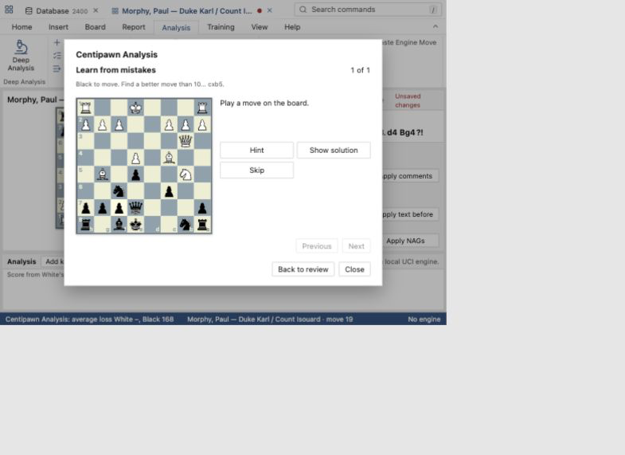
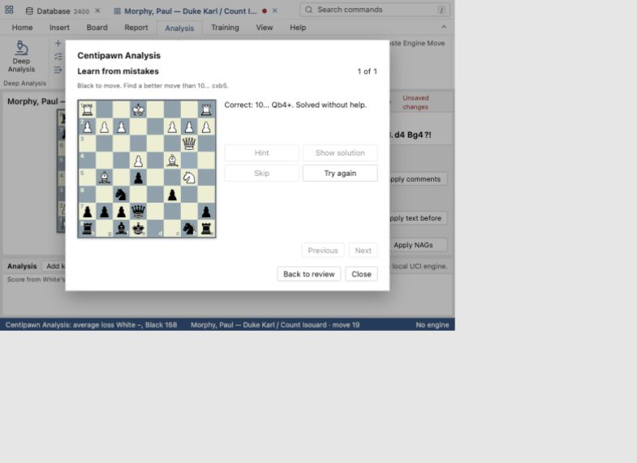

# Guided game review

The Centipawn Analysis dialog now presents a review after its engine pass. It shows estimated accuracy for each side, the existing move category totals, a compact timeline of every analysed move, and a list of inaccuracies and worse moves. Each critical move includes the engine's suggested continuation in SAN when the engine supplied a legal line. Clicking a move closes the dialog and selects that position on the board. Reopening the command shows the saved review without another engine pass while the game's main line is unchanged.

The review uses the same position evaluations and classifications as Centipawn Analysis. The backend retains each position's principal variation from the UCI engine and converts legal moves to SAN. It sends a review item with the game node, ply, SAN, centipawn loss, category and suggested line for each analysed move. The existing annotated game texts are still applied as one undoable edit.

Estimated accuracy is the arithmetic mean of `100 × exp(−loss / 150)` over the analysed moves for a side, where `loss` is the existing, capped centipawn loss (0 to 400). It is a simple, transparent scale for this review, not a calibrated win probability. Forced moves and opening moves are handled as in Centipawn Analysis: the opening is skipped, and analysed forced moves are included.

The game review intentionally follows the existing game window and analysis dialog styling. Its move cards are short and scroll horizontally; the full critical findings sit below. The move labels and engine continuations use algebraic notation rather than UCI coordinates.

## Learn from mistakes

After a review, choose **Learn from mistakes** to practise its inaccuracies, mistakes, missed wins and losing moves. The review's suggested lines disappear while practising. Each exercise loads the board **before** the critical move; click a piece and its destination to try a legal move. Promotions offer a piece choice. The practice board does not add moves or variations to the game.

The saved engine move is the answer. A wrong move leaves the same position available for another try. **Hint** names the kind of piece to consider without showing the move. **Show solution** reveals the engine continuation in SAN. **Skip** records the position without revealing the line. Previous and Next move among the eligible positions; **Try again** hides revealed help. Positions without a legal saved engine move are omitted from practice but remain visible in the review.

Each position is recorded as **solved** when the player finds the saved move on the first attempt without help. A wrong attempt, hint, solution or skip marks it **needs practice**. A later clean retry can mark it solved. The counts appear in the review and persist locally for the same game and main line. Changing the line or the saved engine move starts a separate record. Practice results are local to this installation and do not alter the database or PGN.

Only the engine's first choice is accepted; the review's single line cannot judge other good moves. The hint is a piece type, not a tactical explanation. This practice flow is an OpenFile interaction built on the existing analysis results.

The screenshots below use the browser development preview and its sample game.

