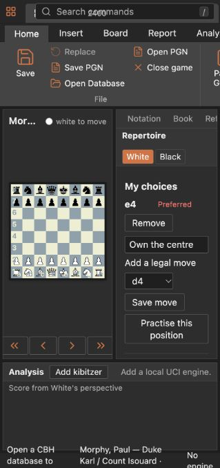
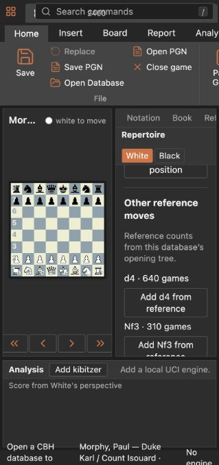
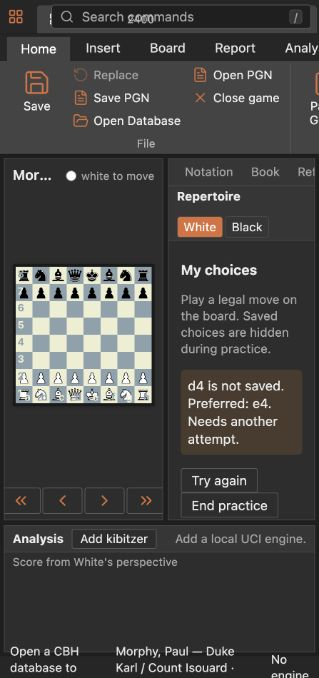
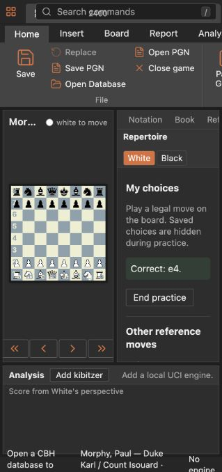

# Repertoire workspace

Open a game or a new board and choose **Repertoire** beside Notation, Book and
Reference. Select **White** or **Black**. The tab shows moves saved for the
current board position in SAN. Choose any legal move from the compact selector,
or add a move from the current database's reference list. Use **Make preferred**
when several of your moves are saved, type a short note (up to 280 characters)
and leave the field to save it, or remove a move. On the opponent's turn the
same controls record replies you want to cover. Navigate the board to the
position after one of your choices to inspect those replies.

**Saved positions** lists the remembered routes and moves. Click one to open
that position on a new board. The route is a bookmark; the position is the
identity. A position reached by a different move order shows the same choices
within that colour's repertoire, even after changing databases. White and
Black repertoires are independent. Identity includes the board, side to move,
castling rights and legal en passant square, and omits move counters. A choice
invalid under the current legal state is shown by its saved UCI with an
**Invalid saved move** badge and can be removed; it cannot pass practice.

The coverage section shows the current database's reference moves and their
game counts. On your turn, unsaved moves are shown. On the opponent's turn,
**Uncovered opponent replies** are moves for which the resulting position has
no legal move saved in your repertoire; click **Answer** to open that position
on a new board. Merely recording the opponent's move does not answer it. The
section says when no tree data exists, when a followed line is
limited and can miss transpositions, or when a search-result sample is shown.
Counts refer to the source named in that label; missing data never means that
all replies are covered. Building the opening tree remains a separate,
cancellable operation. Position changes cancel obsolete Book queries.
Until the new result arrives, the previous position's counts are hidden.

Choose **Practise this position** on your side's turn. Saved moves and notes
hide. Click a piece and its destination on the existing board, including a
promotion choice when needed. Any legal saved move is correct, whether or not
it is preferred. A different legal move is marked **Needs retry**; **Try
again** hides the answer. A later correct answer clears that marker. An
attempt does not add a move or annotation to the game. The saved-position
list shows which positions need a retry. Leaving the tab ends practice, so
normal board moves resume.

The app saves choices to `repertoire-workspace/repertoire.json` and practice
attempts to `repertoire-workspace/repertoire-practice.json` under its app data
folder. Each edit writes a temporary file, syncs it and replaces the old file
atomically. Corrupt or newer-version files are reported rather than
overwritten. Neither file sits beside or changes a `.cbh` or `.2cbh` database.

This is a local manual workspace. It does not import generated repertoire
databases, grade unsaved moves with an engine, sync to a service, or print a
full repertoire tree. The existing Generate Repertoire and Repertoire Report
commands remain separate.

