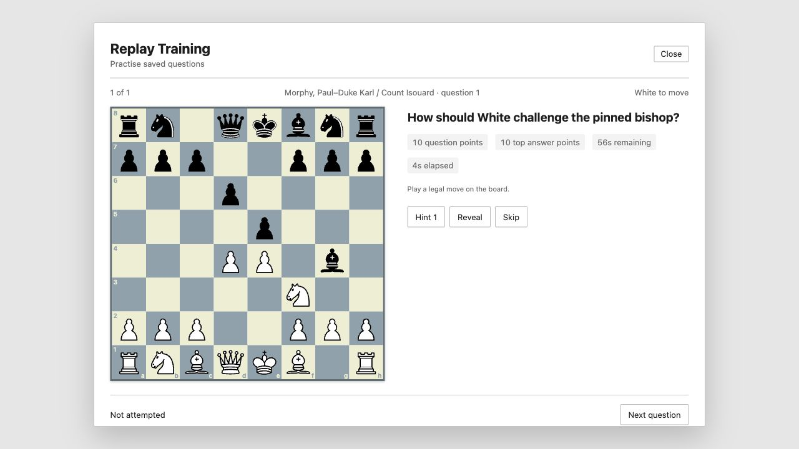
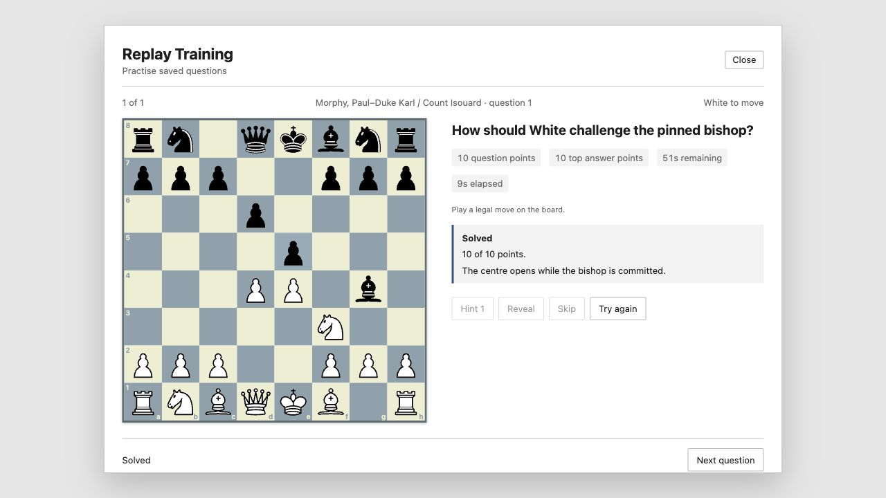
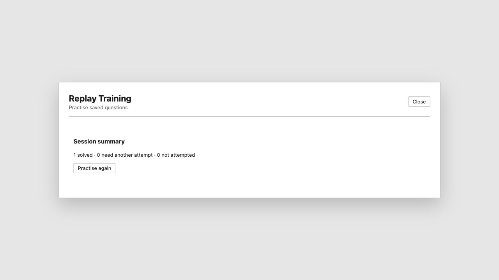

# Replay Training Sessions

Open a game and choose **Training › Replay Training** to practise every saved training question in its main line and variations. In the database window, select game-list rows and choose **Replay Selected Games** to collect questions in displayed row order. The scanning panel shows progress; **Cancel scan** stops after the in-flight game load. Changing databases closes the session and discards any late scan result. Games with no questions are skipped.

The session shows the position **before** the annotated move, with the board turned for the side to move. Future moves and the underlying notation are covered while you answer. For a move question, click a piece and a legal destination, or drag it there with mouse or touch; promotions offer the available pieces. In Chess960, click or drag the king onto its castling rook to castle. For multiple choice, select an authored choice. The annotation's question, score, available answer points and time limit are shown when present. The clock counts elapsed time; expiry records a retry and marks a later correct answer as needing another attempt, but does not lock the board.

**Hint** reveals the next authored hint and its board marks. **Reveal** shows positive-point authored answers and feedback. **Skip** records a retry. A zero-point authored answer displays its saved feedback or default wrong-answer text. A legal move with no authored answer is labelled **ungraded**, with no engine verdict. Positive-point answers display their authored feedback and points. A clean top-point answer solves the question; hints, other attempts, time expiry, reveal, skip, and partial points mark it as needing another attempt. **Try again** hides the answer and help; a later clean top-point answer clears the retry marker. **Next question** advances, and the summary lists solved, retry and unattempted questions for this session. Saved results from earlier sessions appear when a question opens.

Questions with missing text, invalid answer moves or choices, stale parent positions, or no positive-point answer are skipped. The scan reports the count. The move-answer format does not store a promotion role, so queen promotion is the authored answer when several promotions share its squares; other legal promotion choices remain ungraded.

Progress is local to this installation in `replay-training-sessions/progress.json` under the app data folder. The question identity includes its game tags, start position, move path and saved annotation, so changing a question starts fresh progress. The file is written atomically and read after restart. Replay progress does not change `.cbh` or `.2cbh` databases, annotations, game review progress, or repertoire practice. A storage error is shown in the session if progress cannot be loaded or saved.

These screenshots use the browser development preview and an authored sample question:

