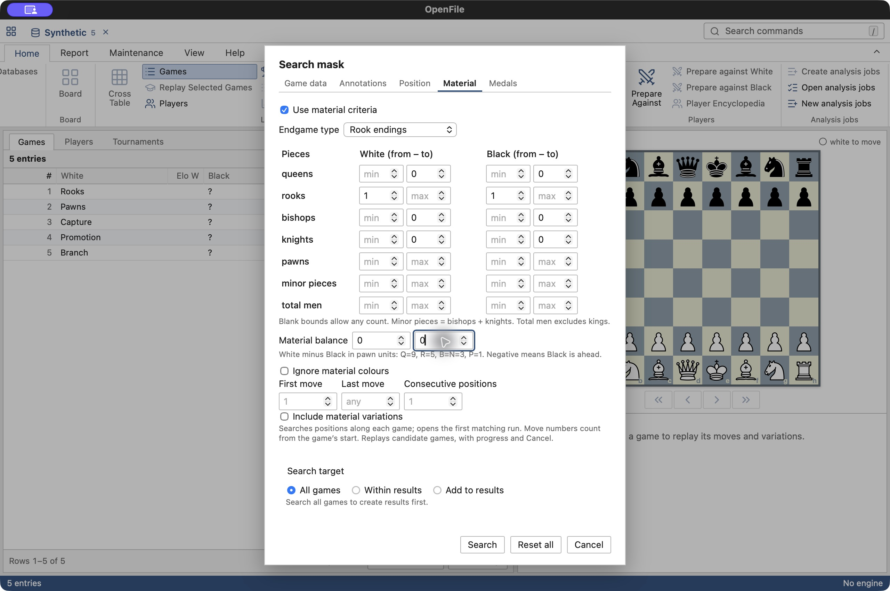
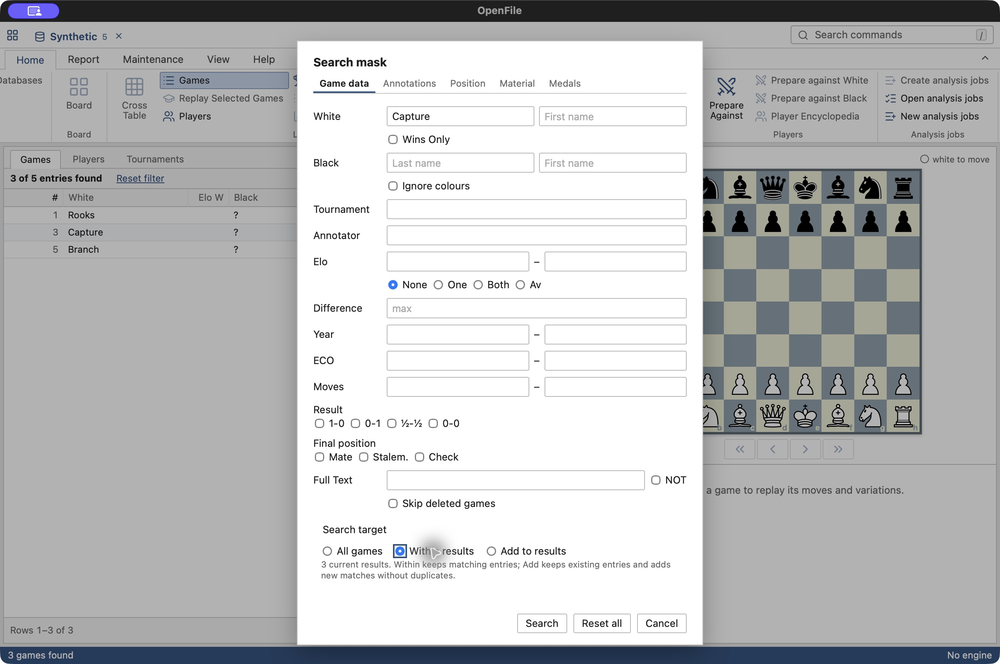
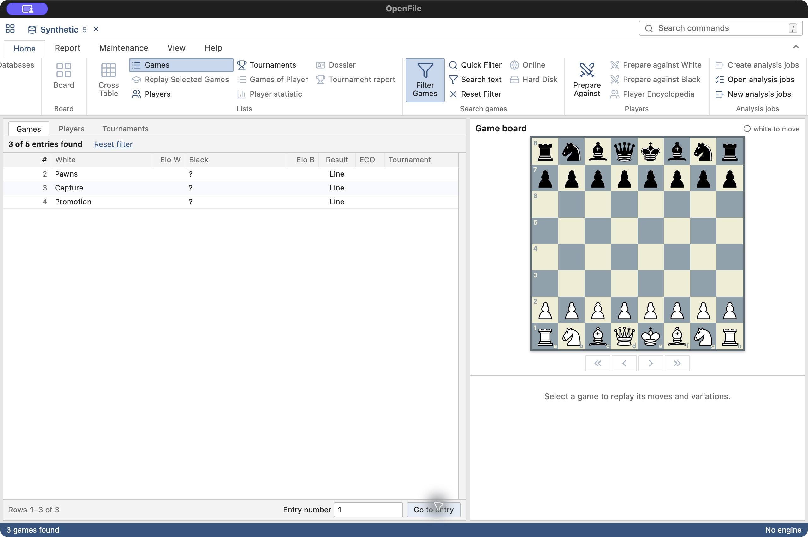
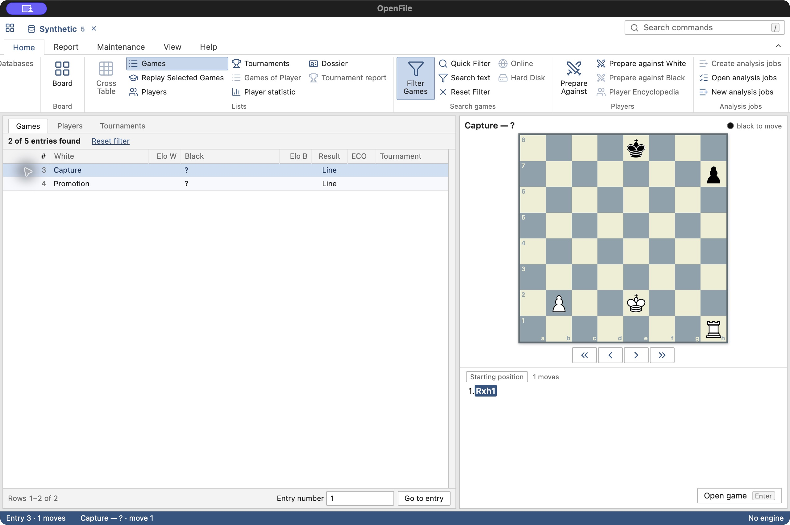

# Searching databases

This note fixes how the workbench searches whole databases. The reference app's search
mask (`OPEN_SEARCHMASK`, dialog resource 310) has tabs for game data,
position, material and more. The field names below follow its game-data tab,
dialog resource **311** in the reference binary. Earlier versions of this note
called it 1031, which is the resource's language (German), not its number.
Nothing here reads or writes the reference app's own search files (Search Booster
`.cit`/`.cib`, `.cbtt`); sources stay read-only.

## Game data

A filter combines any of these fields; every given field must match:

| Field | Matches |
|---|---|
| White, Black | Last name and first name, each a case-insensitive prefix of the stored name |
| Ignore colours | The two player fields may match either colour |
| Wins only | The named player won (with Ignore colours: either side) |
| Tournament | Case-insensitive substring of the event or the site |
| Annotator | Case-insensitive substring of the annotator's name |
| Elo | Range for none, one, both or the average of the two ratings |
| Difference | At most this rating difference between the players; both must be rated |
| Year | Inclusive range; games without a year never match a year range |
| ECO | Inclusive range of codes, A00–E99 |
| Moves | Inclusive range of the stored main-line move count |
| Result | Any of 1-0, 0-1, ½-½, 0-0; forfeits count as their PGN result |
| Mate, Stalem., Check | The main line ends in one of those set; Check means check that is not mate |
| Final material: Equal pieces, Bishop = Knight, Count pawns | The main line's final position has equal pieces, as defined below |
| Full Text, NOT | Case-insensitive text in any text annotation, before or after a move, in any language; with NOT, games without it |

Text entries never match. Deleted games match unless the filter excludes them.

### Quick filter expressions

The compact game-list filter uses the same indexed, parallel game-data scan. It
accepts up to 16 terms. Ordinary words still match names, tournament or site,
annotator, source, ECO, year or result; separate terms combine with AND.

| Example | Meaning |
|---|---|
| `Kasparov- 1985` | White player name contains Kasparov, in 1985 |
| `-Karpov B10-B17` | Black player name contains Karpov, ECO B10 through B17 |
| `Event:"World Championship"` | Event contains the quoted phrase |
| `Site:London` | Site contains London |
| `2001-2011` | Inclusive year range |
| `>2400`, `<=2200` | Average of both players' Elo values; both ratings required |
| `!1/2`, `!Site:London` | Exclude a result or a site |
| `1-0 0-1` | Either decisive result; positive result terms form one OR group |

`White:` and `Black:` are alternatives to the name suffix and prefix. Quotes
keep spaces within any term. Empty values, reversed ranges, unclosed quotes,
invalid rating comparisons and more than 16 terms return an `invalidQuery`
error; no terms are discarded. Negated terms combine with the other criteria.
The quick filter remains a whole-database search, and it can be combined with
criteria already set in the full search mask.

**Native evidence and boundary.** REA 6.1 with Ghidra 12.1.4 traced the
`Filter List` string in the supplied `CBase18.exe` (SHA-256
`8d633b10ad97bd9f8fbbc33a89c279397850ca759c8375093deda4a9485e8dee`):
string `0x14120d160`, references at `0x1408af9c4`, `0x1408af9cb`,
`0x1408b1bc5` and `0x1408b1bcc`. The shipped command resources identify
`M_KC_FILTERLIST` (489), `M_KC_FILTER_BY_NAME` (640),
`M_KC_FILTER_BY_BLACK` (642) and `M_KC_FILTER_BY_WHITE` (643). This supports
the presence of list filtering and colour-specific player filters. It does
not establish an expression parser or its grammar in that executable; the
quick syntax above is the workbench's own design.

**Difference.** In dialog 311, "&Difference:" is an auto-checkbox (control
1079, style `0x50010003`) beside one number field (1023) with an up-down
(1024), in the column of the upper Elo bound. The workbench reads it as a
maximum rating difference. This reading follows the layout and was not
confirmed in the reference app's code. The tab has no source field.

**Final position and text.** Mate, Stalem. and Check are controls 1074–1076;
Full Text and NOT are 1022 and 1081. A game is read only once it passes every
other field:
* for the final position, its move tree is decoded and the main line's end
  is tested;
* for text, only its annotation record is read.

**Final material** is the workbench's own design; the reference app's Material
tab was not traced. In the main line's final position, White and Black must
have the same number of queens, the same number of rooks and the same number
of minor pieces.
* With Bishop = Knight on (the default), bishops and knights are one class,
  so a bishop against a knight is equal. With it off, bishops and knights are
  compared separately.
* Pawns are ignored unless Count pawns is on, which also requires equal pawn
  counts. Kings are always one each.
* The criterion is tested in the same pass as Mate, Stalem. and Check: the
  moves are decoded once, only for games that passed the other fields, and
  a game that cannot be decoded never matches.

Two things were not traced: whether the reference app reads the main line's end or a
stored flag, and whether its Check includes mate. The workbench's choices are
in the table above.

**Not ported from dialog 311:**
* Text with Good and Beautiful (1073, 2338, 2339): their meaning was not
  traced.
* In Repertoire (1897): it needs a repertoire database.
* Time Controls All/Slow/Rapid/Blitz (1315–1319): the game type is not read
  from the records.

## Material search (2026-10-20)

Open **Filter Games → Material**, enable **Use material criteria**, then choose
an endgame preset or enter count ranges. Material is combined with game-data,
annotation and medal criteria using AND. The Position tab continues to submit
its separate position-only query; its boards and other tab criteria do not
combine. Refine results to apply a second kind of search to the same games.

| Criterion | OpenFile rule |
|---|---|
| White / Black Q, R, B, N, P | Inclusive count ranges; a blank bound is unrestricted |
| Minor pieces | Bishops + knights on that side |
| Total men | Q + R + B + N + P; excludes the king |
| Endgame presets | Pawn: no Q/R/B/N; Rook/Queen/Bishop/Knight: that piece on each side, no other non-pawn kind; Minor-piece: at least one minor on each side, no Q/R. Pawns unrestricted, including zero. All ranges remain editable |
| Material balance | White minus Black; Q=9, R=5, B=N=3, P=1; inclusive signed bounds in pawn units |
| Ignore material colours | Try the entire criterion as given and with colours swapped, including the balance sign |
| First / Last move | Inclusive full-move window, counting from the game root as move 1, including a set-up root; root ply 0 through ply `2 × Last − 1` |
| Consecutive positions | At least Length matching consecutive plies (default 1), with a fixed colour orientation throughout the run |
| Include material variations | Off: main line. On: depth-first traversal including variations; sibling branches never contribute to the same run |

Every position in a run must satisfy every material field. The first matching
run supplies the node where the game opens. The starting position counts;
material search does not mean only the final material. Promotions are replayed
normally; there is no pruning based on original queen/rook/minor counts.
Count bounds are integers 0–16, balance bounds −144–144, and move/length fields
1–65,535. Reversed ranges are rejected visibly rather than silently repaired.
An empty enabled material criterion matches every readable game.

### Reference executable evidence and uncertainties

Investigated the supplied ChessBase 18.1 x64 executable, SHA-256
`8d633b10ad97bd9f8fbbc33a89c279397850ca759c8375093deda4a9485e8dee`,
read-only, through PE resource inspection and REA 6.1 / Ghidra 12.1.4. This is
static executable evidence, **not a claim of having run ChessBase on this Mac**.
No executable code, decompiler output or proprietary assets are included in
the product. The following are observed controls and data-flow facts:

- Material is dialog **328**, `CMaterialDialog`, vtable `0x1411e3c68`;
  data exchange `0x1407e13c0`, initialization `0x1407e4030`.
- Five paired piece-count rows exist for each colour. Minor-piece range
  controls are **1022/1024** (White) and **1056/1058** (Black); total range
  controls **1026/1028** and **1060/1062**.
- **Ignore colours 1070**, **Difference 1071**, **Total 1086**,
  **Length 1082**, **Last 1915**, **Any pieces 1084**, **No pieces 1083**,
  **Enter Position 1114**, **Examples 1089**. The outer search mask's
  Include lines is **1285** (dialog 310).
- Difference handler **`0x1407e5010`** changes piece-count spinner limits to
  signed ranges (piece rows ±2, pawns ±8, minors ±12, total ±15) and calls
  `0x1407e62b0`. This establishes a count-difference mode, **not** a
  Q=9/R=5 weighted balance rule.
- Material commit **`0x1407e25d0`** stores the Difference flag at criterion
  offset `0xf8`, copies signed short ranges, stores Length and Last at
  `0x86` / `0x88`, and raises some upper bounds when below lower bounds.
  The exact native replay/duration, total-mode and colour-swap predicates
  were not completely traced. OpenFile's explicit rules above are independent
  choices; its weighted balance and endgame presets are not asserted to be
  ChessBase's Difference mode or Examples list.
- Native pawn-structure, bishop-quality/colour, tablebase and structural
  checkboxes are outside these two checklist items and are not exposed.
  Count-difference mode, entering a board as material and native example
  catalogue are also not implemented; use per-side ranges and weighted balance.

### Execution, limits and measurements

The indexed game-data filter runs first; only surviving games are decoded
for material. Up to eight workers use their own read-only handles. Material
queries retain the first **100,000** hits in entry order, show progress and
can be cancelled between games and during material replay. No material booster
is built or used. On a large database, narrow game-data criteria or refine an
existing result to reduce replay work.

Release measurements on the development Mac, using the existing read-only
reference databases; no games or database companions were copied into the
repository. The selective scan time excludes creation of its initial result.

| Search | Entries examined | Hits | Time |
|---|---:|---:|---:|
| Classic database; year ≥2024; exactly one rook per side, no queens or minors | 11,151,119 index entries | 46,642 | 31.90 s |
| Same rook material within the 3,837 White-Carlsen results | 3,837 | 499 | 0.162 s |
| New-format database; material balance ≥+5 | 24,783 | 11,294 | 0.167 s |

The first measurement replayed only entries passing its year filter; it did
not replay all 11.15 million games. The classic measurement is the repeated warm run (31.58 s first run;
31.90 s repeated); measured peak resident memory was approximately 7.3 MB for
that process. These are measured release runs, not an
estimate for an unrestricted material query. See validation.md for verification
and screenshot details.

## Search all, refine, or add (2026-10-20)

The full search mask has an explicit **Search target** shared by game-data,
material and position searches:

| Target | Rule |
|---|---|
| All games | Search the database and replace the result when complete |
| Within results | Search a snapshot of the current result; keep only matching entry identities |
| Add to results | Search all games; union matches with the captured result |

Within/Add require a current result. An existing **empty** result is valid:
Within scans zero entries and stays empty; Add may find new games. No result
is different from an empty result; unavailable choices are disabled in the
mask and rejected by the backend. The quick filter and direct Find Position
continue to default to All games. Reset all clears criteria and resets the
target to All; Reset Filter removes the current result.

- Identity is the database entry number, not PGN equality or a row number.
  The same entry appears once after combining; separate stored copies of the
  same game remain separate entries.
- Combined results are canonicalized in ascending entry order. The active
  column sort still controls display and paging. Within does not restrict
  itself to the currently loaded page.
- Refining by game data retains previous hit positions. A new material or
  position refinement supplies its new matching nodes. Add keeps an existing
  entry's previous node and supplies nodes for newly added entries; ordinary
  header hits open at the root. Deferred preparation hit positions survive too.
- The operation captures the current result and uses its own reader. Within
  scans only the sorted unique captured entries, batching adjacent ones;
  progress uses that selected count, including zero. The list remains usable.
- Publication is atomic. Cancellation, error, reset, replacement by a newer
  search, an intervening result replacement or database closure leaves no
  partially installed result. Search and booster cancellation-token cleanup
  is guarded by job identity, so an older job cannot erase a newer token.
- Header scans keep at most 2,000,000 matches; material and position scans
  100,000. Add retains existing entries, then the earliest unique new entries
  that fit the **2,000,000 combined-entry cap**. The scan cap includes matches
  already present, so a capped Add can omit later new matches; it reports
  truncation. Incomplete-result warnings remain through subsequent combinations.

**Reference investigation.** Dialog 310's data exchange `0x1406eef80` and
commit `0x1406ef1d0` expose per-tab activation flags and Include lines; they do
not expose All/Within/Add radio buttons. `OpenSearchMaskCmd`'s observed hook
`0x1408b7b10` delegates to the database-list interface. Following the mask's
constructor `0x1406ee770` led to entry `0x1406ded10`, which commits accepted
criteria and schedules `0x1406e2c30`; that function stops the prior worker
and launches `0x1406e3380`. The worker constructs a unique ordered integer set
from candidate entries. This supports native job replacement and entry-set
processing, but does **not** establish the exact UI choice, union/intersection
rules, tie-node policy, ordering or truncation behavior. Those questions were
investigated in REA/Ghidra and remain uncertain. OpenFile therefore uses the
explicit independent set rules above; no native parity is claimed for them.

## Ending tab (2026-10-22)

The **Ending** tab is the workbench's own design, separate from the Material
tab above it in the mask (which follows the reference app's dialog 328 and
tests positions anywhere in a move window). It combines with every other field and is tested in the same
pass as Mate, Stalem., Check and Final material: the moves are decoded once,
only for games that passed the other fields, and a game that cannot be decoded
never matches.

**Count ranges.** Each piece kind takes a range with an optional minimum and
maximum; the select offers any, an exact count, `1+` and `2+`. A count matches
when it lies within the bounds given, and no bound means any.

**Piece counts.** A side's counts have a range for kings, queens, rooks,
bishops, knights, minor pieces (bishops and knights together) and pawns. Every
range given must match. With **No other pieces** (`othersZero`), every piece
kind among queens, rooks, bishops and knights left at any must be 0. Pawns are
not pieces: they keep their own range, so "R + minor, no other pieces" allows
any pawns unless the pawn count is set too.
Also:
* bishops and knights are not forced to 0 when minor pieces are given, and
  minor pieces are not forced to 0 when bishops or knights are given;
* kings are never forced.

**Final position.** White's and Black's ranges are matched against White's and
Black's pieces at the end of the main line. With **Either colour**, the game
also matches when the two sides' counts match the other way round; whole sides
swap, not single kinds. The criterion is on when any range is set or
No other pieces is on for either side. **Bishop = Knight** (the default) shows
the Minor column and leaves bishops and knights at any; off, it shows B and N
and leaves minor pieces at any. It applies to Mate by as well.

**Mate by.** With *Final position is mate by*, the game must end in checkmate,
and the mating side's pieces *involved in the mate* are counted by kind and
matched against a second set of ranges (kings, queens, rooks, bishops or
knights, minor pieces, pawns, and No other pieces). Let M be the mated side, `s`
its king's square and A the mating side. The escape squares are the squares a
king could step to from `s` that M's own pieces do not occupy: empty squares
and squares holding A's pieces. A piece of A, king and pawns included, is
involved when it gives check, or when it attacks at least one escape square.
* The attacks are computed with M's king removed from the occupancy, so a
  slider's attack runs on through `s` and the king cannot step back along the
  checking line.
* Pawns attack only their two capture squares; the king its king-move squares.
* A piece that defends the mating piece's square thereby attacks an escape
  square when that square holds an A piece. In Scholar's mate the bishop
  defending the queen on f7 is involved: `Q,B`.
* Examples: the back-rank mate `Ra8#` involves `R`; a smothered mate involves
  `N`; queen and king against a cornered king involves `Q,K`; a rook mate where
  the king covers g7 and a pawn covers h7 involves `R,K,P`.

Not considered, later work: pins, blockers, and pieces that only defend other
attackers from afar. A game that does not end in mate never matches Mate by.

## Annotations and Medals tabs (2026-10-16)

The reference app's search mask (dialog 310) has, besides game data and position,
an **Annotations** tab (dialog 343, class `CAnnoMaskDialog`, vtable
`0x1411e1b58`) and a **Medals** tab (dialog 312). `Search text`
(`GENERALSEARCH`, kc 597, no key) has no traced action. The workbench opens
the search mask on the Annotations tab for it (database window, Home ›
Search games).

**Annotations.** The data exchange (`0x1407d5530`) and the labels set in
the init (`0x1407d5c50`, messages 490–501, 723):

| Control | Field | Workbench |
|---|---|---|
| Text1 (1109), Text2 (1112) | 0x13000, 0x13008 | each must be in a text annotation, case-insensitively |
| Whole word (1110) | 0x12ff4 | no letter or digit on either side |
| Symbols (1114) | 0x12ff8, a text field | the symbol palette's symbols as checkboxes; each checked symbol must be in the game |
| Any text (1064), Any symbols (1065) | 0x12fc4, 0x12fc0 | the game has a text or a symbol annotation |
| Colours (1058) | 0x12fc8 | coloured squares or arrows (types 0x04, 0x05, 0x84, 0x85) |
| Training (1059), Multimedia (1060) | 0x12fec, 0x12fe0 | types 0x09; 0x10, 0x11, 0x12 (audio, picture, video) |
| Pawn structure (1061), Piece path (1062) | 0x12fe4, 0x12fe8 | types 0x14, 0x15 |
| Critical opening/middlegame/endgame position (1066–1068) | 0x12fd4, 0x12fd0, 0x12fcc | type 0x18 with kind 1, 2 or 3 |
| Variations (1063) | 0x12ff0 | the game has a variation (its moves are read) |

The critical position's kind is the byte the three commands store:
`AnnoCriticalPosOpeningCmd` (`0x1408e0cb0`) passes 1, the middlegame command
(`0x1408e0c50`) 2, and the endgame command (`0x1408e0bf0`) 3. The reader now
keeps it (`Kind::Critical`).

**Medals.** Dialog 312 has one checkbox per medal, in bit order (see
[formats](formats.md)). A game matches when its medal word has any of the
checked bits. This is read from the entry index, without reading the game.

**Combining.** Every criterion set must hold, as for the game-data tab. How
The reference app combines its criteria (any or all symbols, any or all medals) was
not traced; these are the workbench's choices. As with Full Text, only the
annotation record of a game that passes the other fields is read.

**Not ported:** Deleted (1115, 0x12fd8) and Position (1054, 0x12fdc),
whose meaning was not traced, and the Chess960 number (2380, 0x13018).

**Measurements** (classic test database, 11,151,119 entries, release build, warm,
`cbh-reader/examples/search.rs`):

| Search | Hits | Time |
|---|---|---|
| Medal Best game | 318 | 0.92 s |
| User medal | 224 | 0.93 s |
| Critical endgame position | 2,166 | 1.32 s |
| Symbol !! | 11,188 | 1.15 s |
| Text "novelty", whole word | 3,725 | 1.16 s |
| Colours | 48,212 | 1.23 s |
| Training | 2,304 | 1.28 s |

**How it runs.** Name fields are resolved once: the reader scans the name
table (CBP/CBT/CBC or 2LID) and collects the matching ids. The entry index
(CBH or 2CBH) is then read in large chunks by up to 8 workers, each with its
own read handle and range. Each record's ids, date, ratings, ECO, result and
move count are compared. Games themselves are read only for the final
position and text fields.
* The status bar shows the progress; its Cancel link, or Stop Process,
  stops the search.
* A search stops after a configurable number of hits, 2,000,000 by default,
  and the result says when it stopped. The hits kept are the first in entry
  order.

The result is a list of entry numbers kept by the app. The game list then
pages through it in place of the whole database.

## Position search

The search mask's Position tab is the reference app's pattern search: three boards,
mirroring and a move window. See [position search](position-search.md). This
section covers Find Position, and the exact search that the tab shares with
it.

Find Position (game window, Find Position › Hard Disk) looks for the board
and side to move of the current position. Castling rights, en passant and
move numbers are ignored, as in the reference app. It looks through every game,
including variations. Each hit records the first node showing the
position, so the game opens there.

**Search booster.** Create Search Booster (Maintenance) builds the
workbench's own index. It is written to the app's data folder
(`search-boosters/`), never beside the database. The index holds one
128-byte Bloom signature per entry, made of the game's *structure keys*: a
hash of the pawn placement, the piece counts of both sides and the side to
move. These keys change only when a pawn moves or something is captured, so
a game has few of them. A search reads the signatures, keeps the games whose
signature can hold one of the targets' keys, and replays only those.

* An index records the size and modification time of the entry index and the
  move file. It is not used once either changes, for example after saving a
  game.
* It is built by up to 8 workers, each writing its own range of signatures
  into the file in place.
* A cancelled build leaves nothing behind.

**Replay.** A candidate is replayed depth first. A line is abandoned once
either side has fewer pawns, or fewer men, than the target, since neither
can come back (promotion only turns a pawn into a piece). Without a booster
every game is replayed. Position searches keep at most 100,000 hits. The
work is split across up to 8 workers like the game-data search. A worker
stops once the ranges before it hold 100,000 hits, since its own hits would
be dropped.

## Measurements (classic test database, 2026-10-14)

Release build on the 10-core development Mac, warm cache, 11,151,119
entries. Timed with `cbh-reader/examples/search.rs` and `position.rs`.

| Search | Hits | Time |
|---|---|---|
| White "Carlsen" | 3,837 | 1.1 s (3.5 s before the parallel scan) |
| White "Carlsen", Mate | 157 | 1.2 s |
| Year from 2024, Mate | 51,707 of 431,116 games | 32 s |
| Mate, whole database | 769,024 | 126 s |
| Full Text "novelty" | 3,726 | 1.7 s |
| Find Position, Opera Game after 4...Bxf3, no booster | 1,035 | 130 s |
| The same with the booster | 1,035 | 2.6 s (32,769 games replayed) |
| Ruy Lopez after 3.Bb5, no booster | 100,000 (limit) | 108 s (651 s before the read fix below) |
| The same with the booster | 100,000 (limit) | 16 s |
| Pattern: a white knight on d5, no black pawn on c6, c7, e6 or e7, moves 15–40, length 20 | 52,905 | 135 s |
| Building the search booster | 1.43 GB file | 128 s (about 35 min single-threaded, estimated) |

**Reads.** Profiling the first parallel version showed that most of the
time went to the kernel. Every read checked the source file twice by its
path (a `stat`, and an open for the file's identity), and moved a shared
cursor. Now:
* reads are positional, with no shared cursor;
* the path is checked at most every 200 ms;
* every operation still starts with a full check.

On the 2CBH test database a full Find Position went from 2.73 s to 0.65 s on one
worker, and to 0.17 s on eight.

## Search UI evidence

The native macOS debug app was exercised against a disposable five-game
synthetic 2CBH, using the real Tauri commands and Rust readers:

1. All: rook endings, balance 0 → entries **1, 3, 5**.
2. Within: White name Capture, retained material criteria → entry **3**.
3. Add: reset criteria, pawn endings → entries **2, 3, 4**, retaining entry 3.
   Repeating Add kept the same three unique entries in ascending entry order.
4. All: custom material balance ≥+5 → entries **3, 4**. Opening entry 3
   selected **1.Rxh1** (node 1), with the captured rook removed from the board.
5. In the read-only classic database, a synthetic unmatched player prefix
   created an empty result. An Add material-balance ≥+144 job displayed progress
   and Cancel; cancellation retained the empty result and reported Search
   cancelled. Within on that empty result then completed with zero hits.

Screenshots were captured from the native app, inspected, and contain only
synthetic games. The browser preview was also exercised separately; its
illustrative union stayed at 514 IDs after repeated Add. It is not a benchmark
or substitute for the native checks above.

